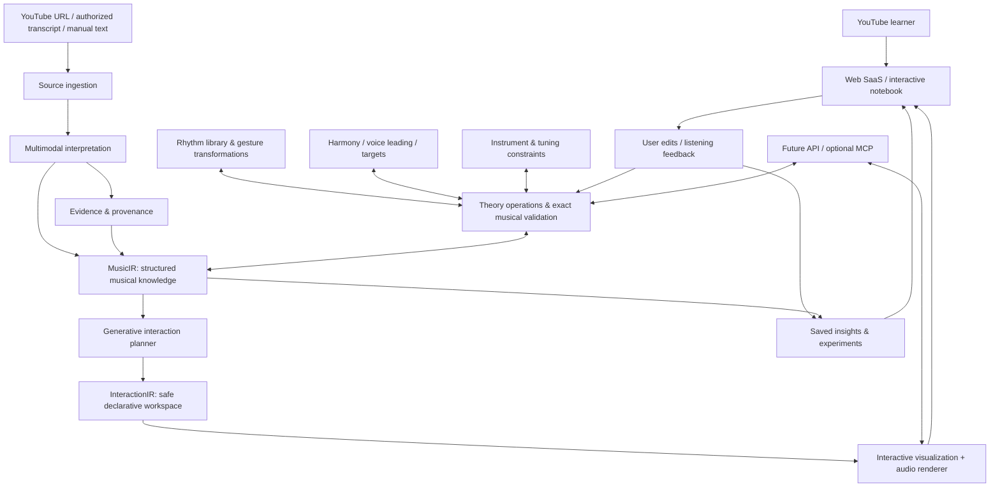
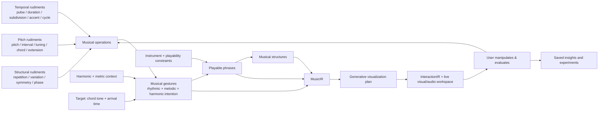

# MUSICAL KNOWLEDGE — PROJECT CONTEXT FOR CLAUDE CODE

> **Status:** Vision / product discovery / technical architecture, **not an implemented product**.  
> **Scope of this document:** ONLY the new application discussed in this conversation. Do not assume any existing guitar app or repository is part of this project.  
> **Intended use:** Give this file to Claude Code in an IDE as context for continuing design, feasibility work, technical specifications, and eventually implementation.  
> **Working title:** Musical Knowledge (placeholder; no name has been selected).

---

## 0. How Claude Code should interpret this document

This document consolidates the **whole discussion about the new application**: the originating problem, the evolving design philosophy, musical rudiments, generative musical interfaces, YouTube ingestion, an optional MCP ecosystem, and a proposed SaaS strategy.

The material is intentionally divided into:

- **Agreed vision** — ideas the user has explicitly embraced.
- **Proposed architecture** — promising approaches, **not** final implementation decisions.
- **MVP proposal** — a recommended way to start, **not** authorization to implement without being asked.
- **Open questions** — choices that remain undecided.
- **Conversation chronology** — user messages and the substantive ideas developed in response.

When working on this project:

1. Protect its **central distinction**: this is **not merely a YouTube summarizer, guitar tab generator, or another online guitar course**.
2. Think of **music-theory knowledge as executable, inspectable, transformable logic**.
3. Preserve links between what the video actually demonstrates, what the system infers, and what the system generates anew.
4. Prefer **deterministic musical computation and validation** where possible; use AI to interpret concepts, choose operations, propose explanations, and design representations.
5. Treat any user-facing musical example as something that must be **theoretically correct, audible, playable, editable, and reversible**.
6. Avoid constructing an unrestricted runtime that blindly executes arbitrary LLM-generated JavaScript in the main application.
7. The YouTube-first SaaS is the market entry; the independent **musical reasoning and representation engine** is the longer-term technical opportunity.
8. The user wants to **continue thinking through and adding ideas**. Do not collapse experimental possibilities into premature fixed product requirements.

---

# PART I — WHY THIS PRODUCT SHOULD EXIST

## 1. The original problem

A self-directed guitarist encounters excellent music-theory videos on YouTube. In the moment, the lesson is illuminating, but its musical insights are soon forgotten, lost among bookmarks and watch history, or remain difficult to translate into practice.

The pain is **not lack of guitar lessons**. It is the gap between:

**watching → understanding → remembering → applying → exploring**.

The product should let a user paste a YouTube lesson URL, extract a small number of meaningful musical insights, then **turn each insight into a playable and editable musical experiment**. The insight becomes a lasting object in a personal music-knowledge library.

Possible concise value proposition:

> **Turn guitar-theory videos into musical knowledge you can play, change, and remember.**

Or, more technically:

> **A generative system that turns musical explanations into manipulable, audible objects.**

## 2. Who it serves first

**Initial audience:** intermediate, self-taught and curious guitarists learning theory, jazz/improvisation, harmony, rhythm, fretboard relationships, and composition from YouTube.

These users already encounter advanced explanations that make conceptual sense but are hard to retain and implement. The initial product should not try to compete with beginner guitar curricula or produce perfect note-for-note tablature for all songs.

**Longer term:** guitar learners at other levels; teachers and YouTube creators; composers and theory enthusiasts; other instruments; developers and AI assistants that need musical reasoning and visualizations.

## 3. Differentiation

Adjacent products include song-chord recognition tools, video-linked notation editors, and practice/audio-separation applications. The proposed product is different:

**Source explanation → understood musical principle → validated musical model → generated interactive environment → saved and revisitable experiment**.

The product focuses on **why an idea works and how to manipulate it**, not only on recognizing which notes someone played.

---

# PART II — THE CENTRAL VISION

## 4. The unit of knowledge is the musical insight, not the video

A video might yield three or four distinct insights. The user should be able to save them separately and eventually connect similar concepts across many videos.

A useful insight object should contain:

- A clear, short headline and a concise explanation (the “alpha information”, not a bloated general summary).
- Original video reference and exact source timestamps where possible.
- A distinction between **observed**, **inferred**, and **newly generated** information.
- The musical relationships and rules that make the insight meaningful.
- One or more interactive, playable realizations.
- User-created variations, edits, tags, annotations, and links to related insights.
- Confidence or uncertainty where recognition or interpretation is ambiguous.

A learner could eventually ask: “Show me what I learned about melodic minor over dominant chords” and retrieve multiple related ideas and editable experiments.

**An insight is an executable knowledge object**, not a frozen text note.

## 5. The key conceptual leap: a generative musical interface

The user explicitly selected the **more ambitious** design: the system should not merely pick one screen from a fixed set of music widgets. It should be able to **compose a new interactive representation based on the logic of a musical idea**.

Examples:

- A scale explanation may generate a fretboard with intervals, roots, patterns, fingerings, and transposition controls.
- A harmony lesson may generate chord progressions, voice-leading trajectories, tension-resolution highlighting, and synchronized playback.
- A melody lesson may generate a pitch/rhythm timeline, a contour view, and a guitar-position map.
- A rhythmic or metric-modulation lesson may generate circular timelines, accent grids, animated phase relationships, and audible layers.
- A geometric interval transformation might need a novel spatial view connected to a fretboard: the engine should not be forced into a conventional tab display.

The **visual representation emerges from musical relationships**. Different visualizations of the same musical object must remain synchronized.

Two capabilities are envisioned:

1. **Composition:** Build an interactive workspace from safe musical/visual primitives (fretboard, strings, dots, pitch events, nodes, connectors, time grids, sliders, transport controls, notation elements, graphs, animations).
2. **Invention:** If existing primitives are insufficient, propose a new visualization and its interaction logic. Initially prefer extending the declarative grammar; later consider carefully sandboxed custom visual components.

The novel interface must remain **musically grounded**, not merely visually impressive.

## 6. A core conceptual hierarchy

The conversation produced a useful abstraction:

**Rudiments → Operations → Gestures → Phrases → Musical structures**.

- **Rudiments:** pulse, duration, pitch, interval, chord quality, subdivision, accent, etc.
- **Operations:** divide, regroup, rotate, transpose, enclose, target, anticipate, delay, substitute, transform, superimpose, etc.
- **Gestures:** a coherent musical action combining temporal, melodic, harmonic, and possibly instrumental intention.
- **Phrases:** ordered gestures connected by musical development and destinations.
- **Structures:** motifs, sections, progressions, multi-voice arrangements, repetitions, variations.

Every level should remain explainable and editable. A user might keep the harmony but change the rhythm, or keep the rhythm while reconstructing the pitches.

---

# PART III — THE MUSICAL KNOWLEDGE GRAMMAR

## 7. Families of foundational logic

### 7.1 Temporal logic

Core entities:

- Pulse and tempo.
- Duration and rests.
- Subdivision (including triplets, quintuplets, septuplets, nested tuplets).
- Accent and accent hierarchy.
- Grouping and meter.
- Cycle and repetition.
- Phase and displacement.
- Polyrhythm (different pulse rates over a shared duration).
- Polymeter (distinct metric cycles or groupings, potentially sharing a pulse).
- Metric modulation (reinterpret a duration/subdivision as the new beat reference).
- Syncopation, anticipation, delayed arrival, suspension across boundaries.

Concepts should emerge as **operations on common primitives**, not as unrelated hardcoded features.

Illustrations:

- Triplet = subdivide a reference span into three equal durations.
- 3:2 polyrhythm = three equal attack spacings and two equal attack spacings across the same total interval.
- 3/4 against 4/4 with shared quarter-note pulse = two accent cycles that reunite after 12 quarter-note beats.
- Metric modulation: if three quarter-note-triplet attacks occupy two old quarter-note beats and each becomes a new quarter-note beat, old 90 BPM maps to new 135 BPM.

**Data representation:** use rational quantities or exact tick/ratio structures for symbolic musical time where possible. Real-time playback scheduling can translate these to seconds separately. The symbolically meaningful relationship must not be lost to floating-point rounding.

### 7.2 Pitch logic

Core entities:

- Pitch and octave; frequency when needed.
- Interval (including direction and musical spelling).
- Pitch class, key, scale, mode, tuning.
- Scale degree, chord degree, chord quality.
- Root, third, fifth, seventh, extension (ninth, eleventh, thirteenth), alterations.
- Arpeggiation, inversion, substitution, transposition.
- Tension, tendency and resolution.

Longer term, do not assume all pitches are 12-tone equal temperament. An extensible pitch/tuning layer should eventually handle arbitrary frequency ratios or tuning systems. The first MVP can use standard Western guitar tuning and 12-TET for scope control.

### 7.3 Melodic-harmonic logic

The user explicitly emphasized:

- **Passing tones**.
- **Neighbor tones**.
- **Chromatic approaches**.
- **Enclosures** (approaching a target from above and below).
- **Arpeggios**, especially ones that land on a chosen chord tone at a deliberate moment.
- **Extensions** and alterations.
- **Voice leading**, including common tones, stepwise movement and independent melodic lines.
- **Targeting** and tension-resolution intent.

The model must distinguish five contexts for a note:

1. **Pitch identity** — what sound/pitch is it?
2. **Harmonic role** — chord tone, third, ninth, alteration, etc.
3. **Melodic role** — passing tone, enclosure note, approach, target, etc.
4. **Metric role** — where does it fall relative to beats, accents, and bars?
5. **Structural role** — destination, transition, suspension, repetition, development, etc.

These roles **are not mutually exclusive**. The same D over Cmaj7 may be the ninth, a destination, an accented note, or a passing note depending on context.

### 7.4 Structural logic

- Repetition and variation.
- Transformation and permutation.
- Symmetry and inversion.
- Augmentation and diminution.
- Displacement, fragmentation, sequence.
- Superposition and counterpoint.
- Phrase continuity, motif identity, expectation and contrast.

These should work across rhythm, melody, harmony and multiple voices.

---

## 8. A central object: TARGET

A target is a **musically meaningful intended arrival**, not simply a pitch name.

A target can specify:

- Harmonic context (e.g., the next Cmaj7).
- Desired degree (e.g., its third, E).
- Register / guitar-position constraints.
- Intended metric arrival (e.g., next chord's downbeat, one eighth late, or an anticipation).
- Approach behavior (chromatic enclosure, arpeggio, leap, passing motion).

Example concept:

```json
{
  "target": {
    "harmony": "Cmaj7",
    "degree": "3",
    "pitch": "E4",
    "arrival": { "kind": "next_chord_downbeat" }
  },
  "approach": {
    "kind": "chromatic_enclosure",
    "upper": "F4",
    "lower": "D#4"
  },
  "constraints": {
    "instrument": "guitar",
    "maxFret": 12,
    "preferStepwiseMotion": true
  }
}
```

This is an **illustrative** representation, not a finalized schema.

The user can modify the intention rather than just moving notes mechanically:

- “Land on the ninth instead.”
- “Keep the pitch target but delay resolution by an eighth.”
- “Retain the harmonic structure and minimize voice-leading motion.”
- “Keep this rhythm, but generate a different melodic realization.”

## 9. A central object: MUSICAL GESTURE

A gesture integrates:

- Harmonic intention and active progression.
- Melodic contour, intervals and roles.
- Rhythm: onset, duration, rest, grouping, accent, articulation.
- Tension/release and intended target.
- Instrumental affordances and playability.
- A trace of the operations that produced it.

This allows a phrase to have **meaning** beyond a list of MIDI notes.

## 10. Harmony + rhythm must be co-generated

The user explicitly rejected a mechanical “everything is eighth notes” solution.

**Rhythm is not an afterthought applied to a fixed melody.** The phrasing generator should consult a vocabulary of rhythmic possibilities and create a musically satisfying arrangement of durations, rests, accents and timing, in conversation with harmonic goals.

Rhythmic gesture vocabulary:

| Gesture | Potential musical effect |
|---|---|
| Acceleration | Increase activity approaching an arrival |
| Deceleration | Make space and emphasize a destination |
| Anticipation | Arrive just before the expected metric point |
| Delayed resolution | Withhold arrival until after a strong beat |
| Syncopation | Put emphasis against expected metric accents |
| Suspension | Extend through a harmonic/metric boundary |
| Displacement | Restart a motif on a new metric position |
| Repetition and variation | Establish then transform rhythmic identity |
| Rest/silence | Create expectation, articulation or breathing room |
| Asymmetry | Unequal groups that avoid mechanical regularity |

An initial **rhythmic library** could tag short cells by durations, subdivisions, density, accent profile, metric alignment, syncopation, motif properties, and stylistic/contextual usefulness. The engine should **recombine and transform** cells, not only retrieve them unchanged.

Candidate phrases should be judged on several **nonuniversal** dimensions:

- Regularity vs irregularity.
- Sparse vs dense note activity.
- Grounded vs offbeat emphasis.
- Predictability vs surprise.
- Phrase coherence, motif continuity, expressive timing, harmonic-target alignment.
- Instrument playability.

“Pleasing” cannot be hardcoded as one objective metric. Generate alternatives, provide user controls/feedback, and allow musical taste to influence ranking.

**Example harmonic scenario:** A line outlines G7 using G–B–D, introduces an upper/lower chromatic enclosure F–D♯, then arrives on E (the third of Cmaj7). Multiple rhythmic settings should turn this **same harmonic intention** into contrasting phrases: regular movement, asymmetric durations, syncopated approaches, or a rest before arrival. These are alternatives, not fixed prescriptive rules.

Also model **polyphony**: bass, inner and upper voices can have independent trajectories and rhythms while sharing harmonic context.

---

# PART IV — THE ENGINE

## 11. Three major reasoning stages

**1. Understanding** — What is being said, shown, diagrammed or played?

**2. Musical logic** — What musical objects, relationships, roles, constraints and transformations are involved? Are they correct?

**3. Generative representation** — What is the most revealing, playable way to make that logic perceivable and editable?

The system should distinguish:

- **Recognition** of a teacher's demonstration.
- **Interpretation** of why the demonstration works.
- **Generation** of new experiments from the principle.

These are separate activities and should be tagged appropriately.

## 12. Two intermediate representations

### MusicIR — musical intermediate representation

Describe the **what** of music:

- Tempo, meter, pulse, time units and events.
- Pitches, voices, tunings and instruments.
- Harmonic progression and chord-role annotations.
- Gestures, targets, constraints and transformation operations.
- Relationships between events and structures.
- Source evidence, timestamps and uncertainty.

Example, stripped down:

```json
{
  "kind": "voice_leading_insight",
  "key": "C",
  "chords": ["Dm7", "G7", "Cmaj7"],
  "thirdTargets": ["F", "B", "E"],
  "tuning": ["E2", "A2", "D3", "G3", "B3", "E4"],
  "provenance": {
    "sourceType": "youtube",
    "status": "example_only",
    "timestampSeconds": null
  }
}
```

This example is intentionally illustrative. Production schemas must be formally validated and include stable IDs, temporal ranges, spelling, source classifications, and versioning.

### InteractionIR — interactive visualization representation

Describe the **how** of seeing, hearing and manipulating it:

- Visual components and arrangement.
- Binding of visuals to MusicIR entities.
- Controls and their musical semantics.
- Interaction → constraint/transformation → recalculation → re-render pipeline.
- Cross-widget synchronization.
- Audio transport, playback state, highlighting, and feedback.

The AI can propose InteractionIR using a **safe, declarative component grammar**. A validator enforces schema and allowed actions. New visualization types should be introduced through an extension process, not unrestricted executable code.

## 13. Musical tools / logical operations

Illustrative callable capabilities:

```text
parse_musical_statement
recognize_guitar_diagram
analyze_chord
analyze_progression
classify_melodic_roles
construct_enclosure
build_targeted_arpeggio
generate_voice_leading
subdivide_duration
regroup_accents
apply_metric_modulation
create_polyrhythm
rotate_phase
generate_phrase_variants
validate_guitar_playability
render_fretboard
render_rhythm_experiment
render_voice_leading
play_musical_experiment
save_insight
connect_related_insights
```

**AI** selects, parameterizes and combines the operations. **Deterministic music logic** calculates and checks exact relationships whenever applicable. A constraint solver may enumerate candidate realizations; a musical evaluation layer ranks alternatives.

## 14. Diagram understanding / multimodal input

Machine learning for reading guitar-theory demonstrations was explicitly proposed. Three ascending levels of difficulty:

1. **Static chord charts:** string/fret grid, dots, open/muted strings, chord names, fingers.
2. **Scale and fretboard diagrams:** notes, roots, degrees, positions and highlighted shapes.
3. **Actual guitar playing in video:** infer finger positions, played string, fret and note with audio/visual corroboration; this remains harder and error-prone.

**Initial approach:** existing multimodal vision models + geometry/symbolic parsing + deterministic reconstruction + user correction. Do **not** train a custom guitar-diagram model before testing how well this approach works.

The engine should connect visual and verbal evidence. Example: a teacher says “move this E-shape barre chord up three frets” while showing the fretboard. The system should use both the observed shape and the stated displacement to reconstruct the new voicing, rather than guessing from either alone.

For video models that sample frames, fast diagrams can be missed. Support targeted frame analysis and explicit uncertainty.

---

# PART V — THE YOUTUBE-LEARNER PRODUCT

## 15. Primary user journey

```text
Paste a YouTube lesson URL
          ↓
Obtain accessible audio/video information and/or transcript
          ↓
Extract a few significant insights with timestamps
          ↓
Interpret each insight as musical logic (MusicIR)
          ↓
Validate what can be checked deterministically
          ↓
Generate a concept-appropriate interactive workspace (InteractionIR)
          ↓
Play, change, test, transpose and generate variations
          ↓
Save the insight and experiments in a personal library
          ↓
Return to it; connect it with insights from other lessons
```

The user should not need to read a giant lesson summary before getting value.

### Example insight cards

- **Chromatic enclosure:** Approach a target chord tone from above and below.
- **Target an extension:** Land on the ninth as harmony changes.
- **Rhythmic displacement:** Move a recurring pattern against the meter.

Each links to original video evidence and opens its own interactive environment.

## 16. The workspace adapts to the concept

| Detected concept | Useful interactive capabilities |
|---|---|
| Scales and modes | Fretboard, interval degrees, positions, transpose, alternate tunings |
| Harmony/progressions | Chord timeline, Roman numerals, substitutions, inversions, voice-leading |
| Melodic phrasing | Editable melody timeline, rhythm, contour, target and approach roles |
| Rhythm | Grids, cycles, accent overlays, phase visualization, metronomic/audio layers |
| Guitar diagram / technique | Fretboard overlays, fingering, fret positions, chord-shape transformation |
| Unusual geometric/musical concept | Newly composed visual representation, safely bound to musical logic |

The engine should **compose** multiple views as necessary. It should not force every concept into the same fretboard display.

## 17. Knowledge library and long-term retention

Library requirements envisioned:

- Saved insight as first-class object, with source/video/timestamp and theory interpretation.
- Saved interactive state and user-created variations.
- Search by concepts, harmonic roles, techniques, source, or instrument.
- Relationships between insights from different teachers/videos.
- Return/revisit experience: recognize, rehear, manipulate, practice.
- Eventually retrieve and combine ideas: “Apply the rhythmic idea from one lesson to the altered-dominant concept from another.”

A **knowledge graph** is a longer-term option; a relational database with tagged relations may be sufficient initially.

## 18. Important source/licensing and reliability constraints

Do not assume every YouTube video can be accessed, downloaded, transcribed or legally analyzed in the same way.

- Direct YouTube URL analysis in multimodal services may be subject to service-specific preview status, supported URL types, quotas and commercial terms. **Verify current documentation before committing to a provider**.
- Respect YouTube's applicable platform policies and content rights; do not design around illicit downloading or storing full video streams.
- Favor source links and attribution; retain only the information legitimately needed for the workflow.
- Include a fallback path for user-supplied notes, authorized transcripts or creator-provided source material.
- Do not misrepresent AI-generated demonstrations as exact transcriptions of the teacher's playing.
- Provide correction controls for wrong chords, note labels, diagrams, timestamps and harmonic interpretations.
- Analyze cost and latency per video before promising free or unlimited processing.

**Recognition accuracy boundary:** speech-based music-theory extraction and symbolic rendering are promising now; precise transcription of fast, polyphonic guitar playing and finger positions is harder and should not be the initial product's central guarantee.

---

# PART VI — PRODUCT AND BUSINESS MODEL

## 19. App vs SaaS

The recommended sequence from the discussion:

**First:** A web-based SaaS, desktop-friendly and responsive on tablet/mobile, with accounts, persistent library, editable experiments and a clear free-to-paid path.

**Second:** A browser extension that sends the current YouTube lesson to the service (e.g. “Make this playable”). This may become a strong acquisition channel.

**Third:** External developer API and optional **MCP server / MCP Apps** interface so assistants, educators and other software can request musical analysis or interactive representations.

### Important clarification about “MPC” / “MCP”

The user originally used **“MPC connector” as a metaphor** for an engine able to adapt logical templates to what a lesson discusses. They later clarified that **the core desire is the reasoning and rendering architecture**, not a required external protocol. Subsequently, making that musical engine available through **MCP (Model Context Protocol)** was welcomed as a potential way to grow interest in the project.

Therefore: **MCP is a distribution/interface opportunity, not the product's core architectural dependency or an MVP requirement.**

## 20. Initial monetization hypotheses (not validated)

Ideas discussed, to be tested only after user validation:

| Plan | Hypothetical price | Hypothetical scope |
|---|---:|---|
| Free | €0 | ~3 video analyses/month, basic interactive insights |
| Musician | ~€12/month | ~20 analyses/month, saved library, richer experiments/export |
| Pro | ~€24/month | ~60 analyses/month, more advanced visual analysis/generation |

Avoid business-plan certainty: numbers are **illustrative hypotheses**, not approved pricing or forecasts. AI-processing cost, conversion, retention and actual willingness to pay remain unknown.

Useful future channels:

- Guitar educators/creators sharing playable companions to their lessons.
- Affiliate creator links or co-branded lesson collections.
- Public shared interactive insights that lead back to the creator/video.
- Later developer and education integrations.

**Retention principle:** The product must become a musical notebook people return to, not a novelty summarizer used once.

## 21. Market entry strategy

Target advanced-beginner/intermediate guitar learners who already watch theory and improvisation videos. Differentiate from song recognition, tab editors, and generic AI summaries.

Early validation idea:

1. Select ~20–30 real guitar-theory lessons across harmony, melody and rhythm.
2. Evaluate extraction accuracy and whether the generated experiments actually embody the insight.
3. Invite ~20–50 engaged learners to use the output.
4. Track whether people **play, edit, save and return**, not merely read summaries.
5. Try creator partnerships and shareable interactive experiments.

Avoid relying on broad online-guitar-market estimates as proof of demand; obtain primary user feedback.

---

# PART VII — PROPOSED TECHNICAL SHAPE

## 22. Logical architecture



### Initial stack — proposal, not decision

- **Web UI:** React + TypeScript, possibly Next.js for product/auth/server routes.
- **Backend:** TypeScript APIs and a job queue for expensive video inference.
- **Data:** PostgreSQL (e.g. hosted service), storing sources, insights, analysis, variations, users, and relationships; object storage only for legitimate required assets.
- **Musical model:** versioned MusicIR schemas and deterministic functions for chords, pitch, duration, constraints, and guitar positions.
- **Audio:** browser-based Web Audio scheduling or a suitable audio framework, separate from symbolic time.
- **AI:** multimodal video/language models, with generated structured output validated before UI use.
- **Generative interface:** safe declarative InteractionIR plus reusable components; sandboxed new components only as a later capability.
- **Integrations:** future browser extension, public API and MCP.

The architecture should permit the music engine to be used **without** the YouTube importer, so it can later support other musical sources and tools.

## 23. State and fidelity requirements

- Deterministic musical rules should produce reproducible results for a given input/seed.
- The UI should allow changes to a musical constraint, then re-run relevant calculations and update all synchronized views.
- Keep a versioned history of generated and user-edited variations rather than silently overwriting an insight.
- Distinguish natural-language explanation, structured data, actual audio event sequences, and visual rendering.
- Support exported musical objects eventually (JSON first; MIDI/MusicXML/tab formats where appropriate).
- An experiment must not silently break instrument/tuning constraints.
- Represent uncertainty as data: a guessed chord, position or interpretation should be correctable, not presented as fact.

## 24. Candidate core objects

```text
SourceVideo
SourceMoment / EvidenceSpan
MusicalInsight
MusicIR
Pitch / Interval / Scale / Chord
HarmonySegment / Progression
Voice / NoteEvent
Pulse / Duration / Subdivision / Meter / Accent / Cycle
RhythmicCell / RhythmicGesture
MelodicGesture / HarmonicTarget
Transformation / Constraint
MusicalExperiment
InteractionIR / VisualizationState
UserVariation / SavedInsight
```

These are conceptual domain objects, **not an instruction to immediately build a large database schema**.

---

# PART VIII — WHAT TO PROTOTYPE FIRST

## 25. First proof: Insight → Experiment

The conversation ended with agreement that **we must start somewhere focused**.

The strongest proposed first milestone is:

> Given a short, concrete music-theory explanation, produce a **correct, editable, audible experiment** expressing the actual musical principle — not just a summary or a generic diagram.

A sensible sequence:

### Stage 0 — Engine proof without video-ingestion complexity

Start from a **manually supplied explanation** of a single concept, e.g. chromatic enclosure / targeting a chord tone. Convert it to MusicIR, validate it, generate an appropriate interactive representation, and let the user modify the target or rhythmic phrasing and hear the difference.

A good reference lesson:

**G7 → Cmaj7.** Use an arpeggio to establish G7, chromatically enclose E using F and D♯, and land on E as the third of Cmaj7. Try multiple rhythmic realizations and different placements of the target.

Critical tasks:

- Interpret the instruction accurately.
- Model source vs inference vs new variation.
- Show theory annotations (arpeggio, enclosure, target).
- Generate playable fretboard notes and audible results.
- Let user change target, rhythmic cell/character and register.
- Recalculate and explain the consequences.
- Save/reopen the experiment.

### Stage 1 — Add selected YouTube lessons

Build a minimal ingestion and extraction workflow for a limited set of legal, accessible source videos. Extract meaningful insights with timestamps, route one insight into the same engine, and make the result shareable/savable.

### Stage 2 — Broaden the musical grammar

Add rhythmic displacement, polyrhythm, metric modulation, voice leading and progression-level analysis. Expand the generative interface grammar. Add strong correction and evaluation tools.

### Stage 3 — Production SaaS and optional ecosystem

Accounts, billing, processing quotas, creator onboarding, extension, search/knowledge relations, monitoring and cost controls. MCP/API only when the independent engine and use cases justify it.

## 26. A specific quality test for the ambitious vision

Test whether the system can generate **useful, different interfaces** for three intentionally dissimilar concepts:

1. ii–V–I melodic targeting and voice leading.
2. A polyrhythm / polymeter or metric-modulation concept.
3. A geometric, symmetrical or otherwise unusual interval transformation.

Then attempt a combination that is **not represented as a predesigned screen**, e.g. nested tuplets with accent rotation against an independent 7-beat cycle.

Success requires:

- Correct musical relationships.
- Intelligible visualization.
- Working musical controls.
- Corresponding audible playback.
- Explanations of what changed and why.

A gorgeous but incoherent generated UI does not count as success.

## 27. MVP acceptance criteria to refine with the user

The first working slice should demonstrate that a user can:

- Supply a short music-theory explanation (and later a video URL).
- Receive a concise, accurate insight.
- Open a concept-specific interactive experiment.
- Hear the result and see a meaningful visual mapping.
- Modify at least **one harmonic parameter** and **one rhythmic parameter**.
- See changes reflected consistently across visuals and audio.
- Preserve the result for revisiting.
- Inspect the difference between source evidence, model interpretation and generated variations.

The exact UI, model provider, persistence provider, and monetization implementation remain open choices.

## 28. Things explicitly NOT to overbuild for the first slice

- A full DAW or complete guitar tab editor.
- General-purpose transcription of any guitar solo or dense polyphonic audio.
- Universal recognition of fingering from arbitrary video.
- Social media features.
- Native iOS/Android apps.
- A large fixed catalog of every theory topic.
- Unrestricted LLM-generated app code.
- Custom ML training pipeline before basic vision-model benchmarking.
- A full MCP platform before the core product works.

**Do not simplify away the core innovation**: the lesson must become a meaningful musical experiment with actual transformations.

---

# PART IX — STRUCTURAL REFERENCE GRAPH

This second diagram focuses on the musical knowledge grammar and its route into a generative interface.



**Foundational principle:** One musical model, many coherent representations. A change to the musical object propagates to the fretboard, notation/graph, explanatory text and audio.

---

# PART X — OPEN QUESTIONS / IDEAS TO EXPLORE

These were not settled and should remain available for discussion:

1. How free should the AI be to invent entirely novel interface components? Where does the declarative grammar end and sandboxed extension begin?
2. Which rhythmic gestures/parameters best predict a **convincing phrase** without imposing one aesthetic ideal?
3. What is the right balance between a curated rhythmic vocabulary and constraint-based novel generation?
4. How should the engine represent target arrivals, enharmonic spelling, voice identities, and counterpoint in a fully typed model?
5. How should source evidence and model confidence be shown without cluttering the music workspace?
6. Which YouTube materials can be processed legally and reliably for a commercial product under current provider/YouTube terms?
7. Can guitar-specific multimodal recognition consistently parse real lesson diagrams, or will correction workflows be essential?
8. What are realistic costs/latency for a typical 10–30 minute lesson, and should analyses be cached/shared?
9. Which user action best predicts retention: saving, changing an experiment, listening again, or revisiting days later?
10. How far should the engine support alternate tunings and non-12-TET systems in early versions?
11. Will creators want to author/verify interactive companions to their own lessons?
12. What belongs in the first truly compelling “Insight → Experiment” demo?
13. What product name and visual identity express musical intelligence without looking like a generic guitar-course app?

---

# PART XI — CHRONOLOGY OF THE ACTUAL DISCUSSION

This section preserves **every user turn specifically about the new application** and records the significant concepts developed in the corresponding responses. User quotes retain their original wording where possible; assistant material is condensed, rather than copied with all previous UI prototypes, into a comprehensive technical/product narrative above.

### Turn 1 — Origin: forgettable YouTube insights

**User:**

> ok, we'll do it latter, i am thinking of a new app, what problem does it solve? i keep seing amazin guitar theory videos and keep forgetting its insights, i want to build an app that takes an url from youtube, and just gives me th alpha information, a sumary of what was said, i kind of want to make the app apply the concept, we could have a guitar layout and it could transcribe the alpha information into something that is playable on the fretboard, is this possible or are we not there yet?

**Ideas developed:** More than video summarization. Extract a few “insight cards” with original timestamp and produce interactive/playable illustrations; multimodal models can interpret speech and visuals, but transcription of complex guitar performances is less reliable. The lasting unit is the insight, not the video.

### Turn 2 — Adaptable musical reasoning, guitar diagram understanding

**User:**

> ok i am thinking, machine learning for guitar diagrams understanding and kind of thinking of the app like an MPC connector, meaning it would have the logic to adpat to whats being said about notes chords, progressions, melodies

**Ideas developed:** Multimodal diagram recognition and a musical reasoning layer with specialized operations. Different concepts call for different interface elements; symbolic theory validation must support extracted visual/audio/text evidence.

### Turn 3 — Generative interfaces, not just template selection

**User:**

> yeah the second one, MPC concept was just a metaphore, trying to import a concept to describe what the engine would do, it renders information into logical templates, but exposing an MPC connection is also a great idea that could sustain the project interest

**Ideas developed:** The engine should **generate new interactive visualizations** rather than only select predefined widgets. MusicIR and InteractionIR were introduced conceptually. A future MCP interface may make the engine accessible to third-party AI hosts, but is secondary to its reasoning/rendering function.

### Turn 4 — Rhythm as foundational logic

**User:**

> right, rudiments of musical theory become building logical block, rythm is an especially interresting aspect, like triplets, metric modulation, polymetric approch, polyrythm approch, accents

**Ideas developed:** Pulse, subdivision, duration, accent, grouping, phase, cycle and tempo relationships as primitives. Tuplets, polyrhythm, polymeter and metric modulation as mathematical operations. Rhythm considered a strong starting point to test generative musical interface logic.

### Turn 5 — Melodic harmony and targets

**User:**

> For harmony it needs the concept of passing tones and enclosures, arpegios landing on a particular chord tone, extensions and voice leading

**Ideas developed:** Harmonic identity, passing and neighboring tones, chromatic enclosures, target-note arpeggios, voice leading and extensions. Distinguish pitch, harmonic, melodic, metric and structural roles. Introduced `Target` as a note + chord role + desired arrival + approach + constraints. Example: G7 to Cmaj7 with an enclosure around E.

### Turn 6 — Rhythm and phrase aesthetic

**User:**

> Yeah phrasing needs to be able to reach rudiments of rythm, like not be all eight notes but combine durations by consulting a library of possibilities and find a combination that works pleasingly

**Ideas developed:** Rhythm must be co-generated with melody, not added afterward. A vocabulary of rhythmic gestures and a combinatorial generator should create different viable phrases. Musical evaluation should be multidimensional and learned/refined through user feedback, not one universal “pleasing” score. Introduced a `MusicalGesture` combining harmonic purpose, contour, rhythm, articulation, and target. Hierarchy: rudiments → operations → gestures → phrases → structures.

### Turn 7 — A printed high-level vision map

**User:**

> cool, make me a pdf with 2 pages with concept and structural graph, hi vision so i can print it and look at it every day, it becomes easier to reason about this, i wanna think this through and add more ideas maybe

**Ideas developed:** The vision is intentionally a **living conceptual system**. A two-page high-level concept/architecture diagram was discussed and produced in the conversation. This document provides the textual source of truth for further reasoning, without relying on that file.

### Turn 8 — Should it target YouTube learners? App or SaaS?

**User:**

> ok should we cater this to youtube learners, its a huge market worldwide, and tell me the solution for this coming to like, an app or a SaaS

**Ideas developed:** Yes: use YouTube guitar learners as market entry while keeping the music engine independent. Propose responsive web SaaS first, browser extension next, API/MCP later. Freemium/subscription hypotheses. Differentiate from online guitar courses, tab/transcription and chord apps. Validate with real lessons, user engagement and creators. A phased technical architecture and compliance/cost caveats were raised.

### Turn 9 — Agreement to start small and request for handoff

**User:**

> i agree we have to start somewhere first. can you make a document that contains this whole conversation so i can give it to claude code in an ide?

**Implication:** The immediate deliverable is a **complete context handoff**, not a premature implementation. The suggested first engineering experiment is a narrow, demonstrably correct **Insight-to-Experiment** slice.

### Turn 10 — Scope correction

**User:**

> no just the new app

**Implication:** This document deliberately covers **only this new YouTube-to-playable-musical-knowledge product and its independent musical engine**. It does not specify or depend on any earlier app discussed outside these turns.

---

# END — GUIDING STATEMENT

> **The video is a source, the insight is the knowledge, the musical logic is the engine, and the interactive experiment is how knowledge becomes something a musician can actually use.**

> **Rudiments become operations; operations become gestures; gestures become phrases; phrases become structures. The engine reasons about these relationships and constructs the most revealing playable interface for them.**

**Next ideal instruction for Claude Code:** “Read this document as project context. Help me define the smallest credible technical proof of Insight → Experiment, preserving the longer-term generative musical engine vision. Do not build the full SaaS or assume unmade decisions.”
